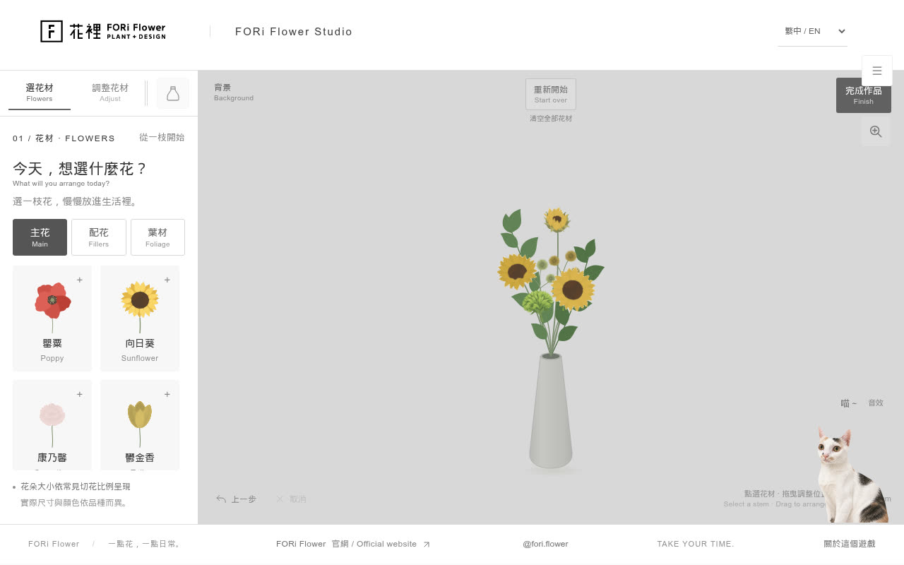

# 🌸 FORi Flower Studio — 花裡 FORi Flower 線上插花體驗

**Interactive Digital Floral Arrangement & Botanical Greeting Card Studio**

[](https://kunruiw1991.github.io/fori-flower-studio/)
[](https://github.com/kunruiw1991/fori-flower-studio)

- **Live Playable App**: [https://kunruiw1991.github.io/fori-flower-studio/](https://kunruiw1991.github.io/fori-flower-studio/)
- **Source Repository**: [https://github.com/kunruiw1991/fori-flower-studio](https://github.com/kunruiw1991/fori-flower-studio)
- **Original Inspiration Video**: [Facebook Watch — 花裡 FORi Flower 線上插花體驗 (v=1530985749053109)](https://www.facebook.com/watch/?v=1530985749053109)



---

## ✨ Overview

**FORi Flower Studio (花裡 FORi Flower 線上插花體驗)** is a zero-dependency, browser-based interactive floral arrangement studio inspired by the [FORi Flower online floral arrangement showcase video](https://www.facebook.com/watch/?v=1530985749053109). Craft bespoke floral arrangements on an HTML5 Canvas with custom vector botanicals, real-time stem physics and geometry controls, personalized greeting card typography, 8-second time-lapse creation video export, and a persistent personal gallery (**我的花室 / My Flower Room**).

---

## 🌿 Complete 4-Step Floral Arrangement Guide

### Step 1: Choose Containers (`1. 選擇容器 / Containers`)
Select the vessel and set the mood of your studio scene:
- **Vases (`花器`)**:
  - **Classic (`經典花瓶`)** — Balanced ceramic silhouette for full arrangements
  - **Slim Neck (`細頸瓶`)** — Elegant narrow-neck bottle for tall stems
  - **Mini (`迷你瓶`)** — Compact tabletop bud vase
  - **Mini Neck (`小頸瓶`)** — Petite rounded-neck vessel
  - **Cylinder (`圓柱高瓶`)** & **Amphora (`雙耳陶甕`)** — Architectural studio vessels
- **Bouquets (`花束`)**:
  - Kraft Paper Wrap (`牛皮紙花束`), Frosted Organza (`霧面歐根紗`), Korean Ribbon Wrap (`韓式緞帶花束`), Linen束 (`亞麻手綁花`)
- **Imagination (`想像力`)**:
  - Teacup (`午後茶杯`), Watering Can (`復古澆花壺`), Woven Basket (`編織花籃`), Floating Bowl (`水盤花器`)
- **Color Customization**:
  - **Vase Color (`花器顏色`)** — Curated ceramic glazes and wrap color swatches
  - **Background (`背景`)** — Warm studio paper, sage mist, blush linen, midnight botanical, and sunlit cream backdrops

### Step 2: Pick Botanicals (`2. 選花材 / Flowers`)
Click any botanical card to add stems to your arrangement across three curated categories:
- **Main Flowers (`主花`)**:
  - **Sunflower (`向日葵`)** — Radiant golden petals with textured seed disk
  - **Carnation (`康乃馨`)** — Ruffled layered blooms for warmth and gratitude
  - **Tulip (`鬱金香`)** — Sculptural cup-shaped spring petals
  - **Gerbera (`非洲菊`)** — Cheerful daisy-like focal flower
  - **Rose (`玫瑰`)** — Classic spiral-petalled romantic bloom
- **Filler Flowers (`配花`)**:
  - **Baby's Breath (`滿天星`)** — Delicate cloud-like white clusters
  - **Oncidium (`文心蘭`)** — Dancing lady orchid sprays with golden-speckled blooms
  - **Button Mum (`鈕扣菊`)** — Crisp pompon chrysanthemum accents
  - **Japanese Dianthus (`深山櫻`)** — Starry five-petal woodland blossoms
- **Foliage (`葉材`)**:
  - **Beech (`椈木`)** — Graceful branching woodland leaves
  - **Green Bamboo (`綠石竹`)** — Lush textural green dianthus / foliage sprays

### Step 3: Fine-Tune (`3. 調整花材 / Adjust`)
Select any stem directly on the canvas or from the layer list to sculpt your composition:
- **Direct Canvas Manipulation**: Drag flowers freely on the canvas to position stems naturally within the container mouth
- **Stem Height (`花材高度 cm`)**: Continuous slider (`15 cm` – `55 cm`) adjusting stem length and bloom elevation
- **Tilt Angle (`傾斜角度 °`)**: Continuous angle control (`-60°` to `+60°`) with natural Bezier stem curvature
- **Flower Color (`花色`)**: Instant per-stem petal palette swatches (blush pink, coral, buttercream, lavender, ruby, ivory, sky blue, and botanical greens)
- **Layer Ordering (`圖層順序`)**:
  - **To Front (`最前 To front`)** / Bring Forward (`上移`)
  - **To Back (`最後 To back`)** / Send Backward (`下移`)
  - Duplicate or delete individual stems, or generate an instant balanced bouquet with **Auto-Arrange (`靈感自動插花`)**

### Step 4: Finish & Share (`4. 完成作品 / Finish`)
Turn your arrangement into a keepsake greeting card or shareable video:
- **Greeting Card Message**:
  - **Recipient (`送給 To`)** — Personalized addressee line
  - **3-Line Blessing (`祝福的話`)** — Three poetic lines rendered directly on the floral card
  - **Signature (`署名 From`)** — Sender sign-off and date stamp
- **Export & Keepsake Modes**:
  - **Download Vertical Card (`下載直式圖片`)** — High-resolution vertical PNG greeting card ready for messaging or social stories
  - **8-Second Creation Replay Video (`製作創作影片`)** — Generates a smooth 8-second animated time-lapse (`WebM` / video replay) showing your arrangement being built stem-by-stem from vessel to final card
  - **My Flower Room (`我的花室 My Flower Room`)** — Save arrangements to your personal browser gallery to revisit, reload, or compare creations
  - **ibon / Postcard Export (`ibon 明信片列印 / 實體卡預覽`)** — Formatted 4×6 postcard layout with print framing and QR code metadata

---

## 🌍 Multilingual Support (7 Languages)

Switch languages seamlessly at any time from the top navigation bar:

| Language | Native Label | Coverage |
| :--- | :--- | :--- |
| **Traditional Chinese** | `繁體中文` | Full UI, botanical names, poetic presets & card templates |
| **English** | `English` | Full UI, botanical names & greeting presets |
| **Japanese** | `日本語` | Full UI, floral terminology & seasonal greetings |
| **Korean** | `한국어` | Full UI, floral terminology & greeting templates |
| **French** | `Français` | Full UI, French atelier botanical labels & greetings |
| **Spanish** | `Español` | Full UI, botanical labels & card templates |
| **German** | `Deutsch` | Full UI, botanical labels & card templates |

---

## 🚀 Local Quick Start

No build step or external dependencies required. Serve the static files with any HTTP server or open `index.html` directly:

```bash
python3 -m http.server 8080
# Open http://localhost:8080 in your browser
```
